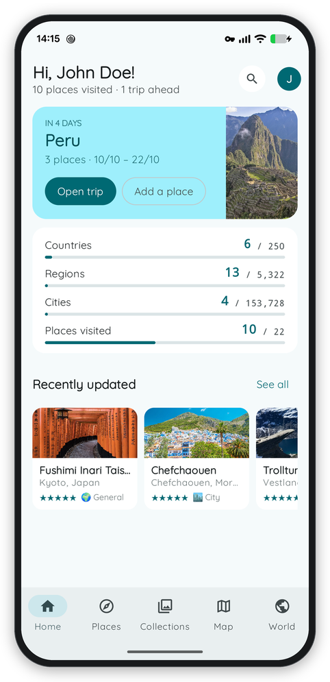
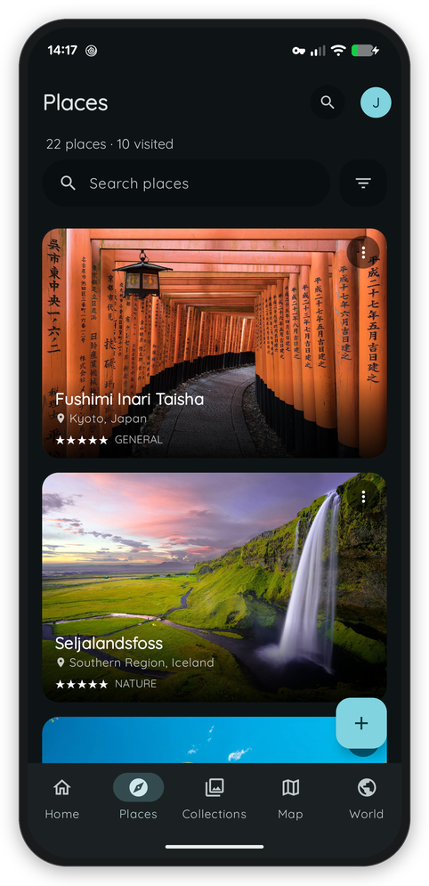
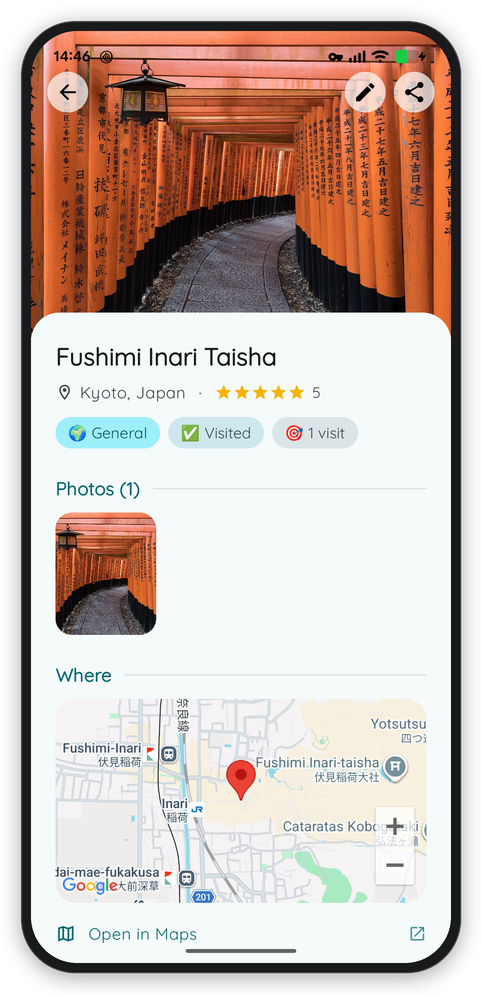
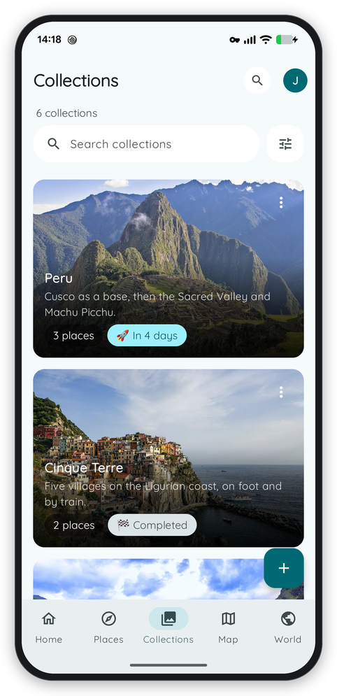
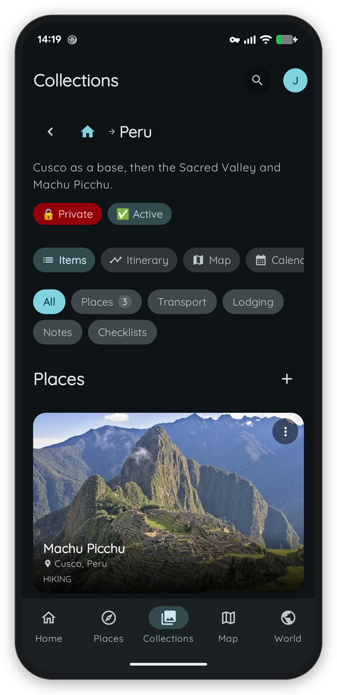
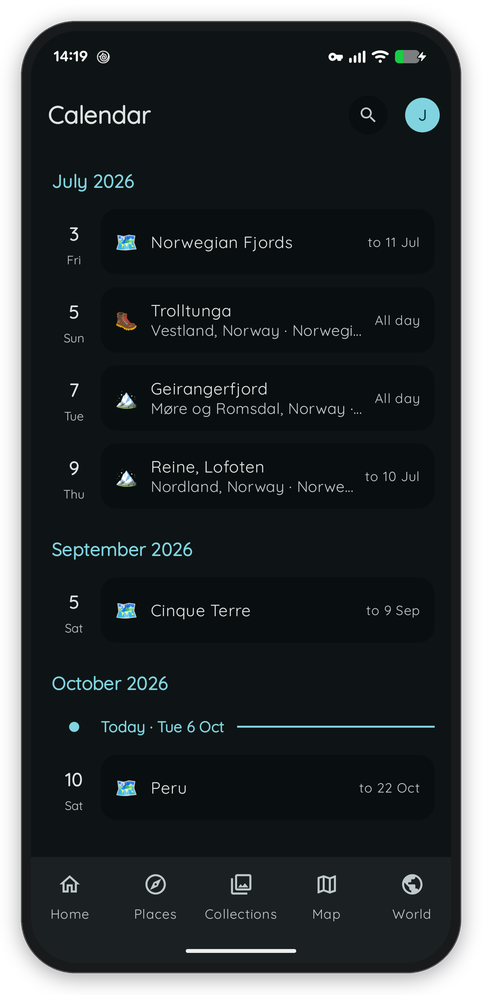
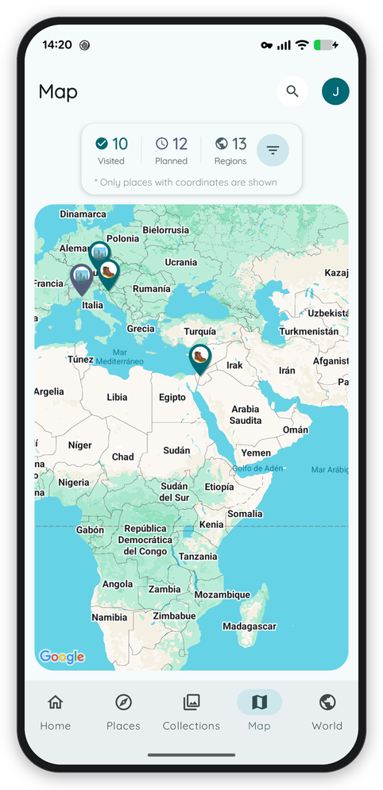
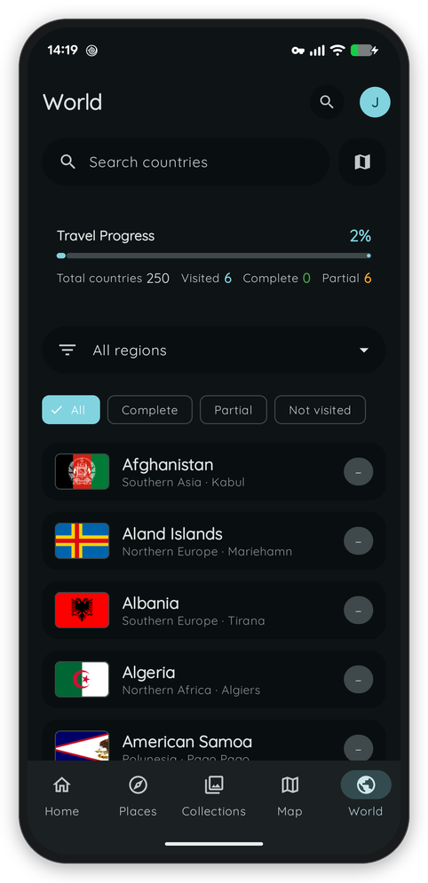
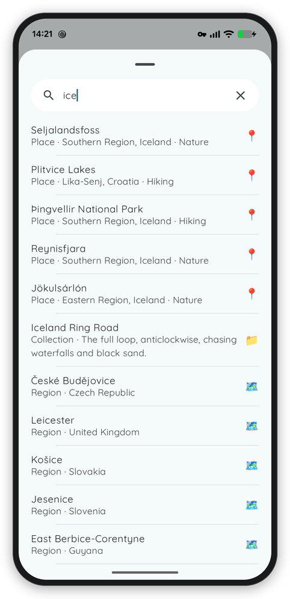

# 🏕️ Adventure Log


A mobile client for [AdventureLog](https://github.com/seanmorley15/AdventureLog), the self-hosted
travel journal, built with Kotlin Multiplatform and Compose Multiplatform. Log the places you have
been, group them into trips, and see it all on a map, a calendar and a world of visited countries.

**Android** is the primary platform and is where everything is tested. **iOS** builds and runs,
but has had far less use and is not distributed yet.

## 🌟 Features

- **Places**: add, edit and search them, with photos, notes, links, dates and categories
- **Collections**: trips that gather their own places, transport and lodging
- **Map**: everything with coordinates, clustered and filterable
- **Calendar**: everything with a date on it, as an agenda you can scroll and filter
- **World**: countries, regions and cities visited, with statistics
- **Search**: one box for places, collections, cities and countries
- **Sharing**: invite someone with a public profile to a collection, or remove them again
- **Markdown descriptions**: rendered as written on the web
- **Tablets**: navigation rail, adaptive grids and list-detail panes for Places and Collections

## 📲 Install

This is a *client*: it needs a
[self-hosted AdventureLog server](https://github.com/seanmorley15/AdventureLog) to talk to.

Download the APK from the [latest release](https://github.com/DesarrolloAntonio/AdventureLog-Client/releases/latest)
(Android 7.0 and up), then sign in with your server's address and your account.

Bug reports are welcome as [issues](https://github.com/DesarrolloAntonio/AdventureLog-Client/issues/new):
what you did, what happened instead, and the device and Android version. A screenshot helps.

## 📱 Screenshots

<table>
  <tr>
    <td align="center" width="33%"><br/><sub><b>Home</b><br/>what is coming up, and where you have been</sub></td>
    <td align="center" width="33%"><br/><sub><b>Places</b><br/>everywhere you have logged, searchable</sub></td>
    <td align="center" width="33%"><br/><sub><b>A place</b><br/>photos, notes, links and dates</sub></td>
  </tr>
  <tr>
    <td align="center" width="33%"><br/><sub><b>Collections</b><br/>trips, each gathering its own places</sub></td>
    <td align="center" width="33%"><br/><sub><b>Inside a collection</b><br/>places, transport and lodging</sub></td>
    <td align="center" width="33%"><br/><sub><b>Calendar</b><br/>the journal by date</sub></td>
  </tr>
  <tr>
    <td align="center" width="33%"><br/><sub><b>Map</b><br/>everything with coordinates, clustered</sub></td>
    <td align="center" width="33%"><br/><sub><b>World</b><br/>countries, regions and cities visited</sub></td>
    <td align="center" width="33%"><br/><sub><b>Search</b><br/>one box for places, trips and regions</sub></td>
  </tr>
</table>

<sub>Android, on a Pixel 6a, light and dark theme. Photos come from Wikimedia Commons through the
server's own image search.</sub>

## 🏗️ Architecture

Clean Architecture split into Gradle modules: `core` holds the domain, data and network layers,
and each screen lives in its own `feature` module. ViewModels expose immutable UI state as
`StateFlow`.

```
AdventureLog/
├── composeApp/           # Android and iOS entry points, app-wide navigation and DI
├── iosApp/               # Xcode project
├── build-logic/          # Gradle convention plugins
├── core/
│   ├── common/           # Utilities and extensions
│   ├── data/             # Repository implementations
│   ├── domain/           # Use cases and repository interfaces
│   ├── model/            # Domain models
│   ├── network/          # Ktor client and API DTOs
│   ├── permissions/      # Runtime permissions
│   └── testing/          # Hand-written fakes shared by the tests
└── feature/
    ├── calendar/         # Dated events as an agenda
    ├── collections/      # Collections and what is inside them
    ├── detail/           # A place's own page
    ├── home/             # App shell, navigation bar and dashboard
    ├── locations/        # The places list, and adding or editing one
    ├── login/            # Sign-in
    ├── map/              # Map
    ├── settings/         # Account and app settings
    ├── ui/               # Shared UI components and theme
    └── world/            # Countries, regions and cities
```

**Stack:** [Compose Multiplatform](https://www.jetbrains.com/compose-multiplatform/) with
Material 3 · [Navigation 3](https://developer.android.com/guide/navigation/navigation-3) and
Compose Navigation · [Koin](https://insert-koin.io/) · [Ktor](https://ktor.io/) ·
[Kotlinx Serialization](https://github.com/Kotlin/kotlinx.serialization) ·
[Coil](https://coil-kt.github.io/coil/) ·
[Multiplatform Settings](https://github.com/russhwolf/multiplatform-settings) · Coroutines and Flow

## 🚀 Building

**Requirements:** an Android Studio recent enough for AGP 9.2, JDK 17, and Xcode 26 for iOS
(deployment target 15.3).

```bash
git clone https://github.com/DesarrolloAntonio/AdventureLog-Client.git
cd AdventureLog-Client
```

- **Android**: open the project in Android Studio and run the `composeApp` configuration.
- **iOS**: run `./gradlew :composeApp:embedAndSignAppleFrameworkForXcode`, then open
  `iosApp/iosApp.xcodeproj` in Xcode and run it.

## 🧪 Tests

- **Unit tests** (`commonTest`, on Android and iOS): models, mappers, use cases, the network and
  data layers, and every feature's ViewModels, using the fakes in `core/testing`.
- **UI tests** (`androidInstrumentedTest`, need a device or emulator): screens and shared
  components in `collections`, `home`, `calendar`, `locations` and `ui`.
- **Flows**: one Maestro flow in `.maestro/`.

```bash
./gradlew allTests testDebugUnitTest      # unit tests, every target
./gradlew connectedDebugAndroidTest       # UI tests, with a device attached
```

CI runs the unit tests and builds the app; the UI tests and the Maestro flow run locally.

## ⚠️ Known issues

- **MFA and SSO**: accounts that use them cannot sign in yet.
- **Back on iOS**: going back from a half-filled form skips the "discard your changes?" question
  (Cancel still asks), and there is no system back gesture.
- **Date picker on iOS**: it used to crash; the Compose Multiplatform upgrade should have fixed it,
  but that is not yet confirmed on a device.

## 📄 License

MIT - see [LICENSE](LICENSE).
