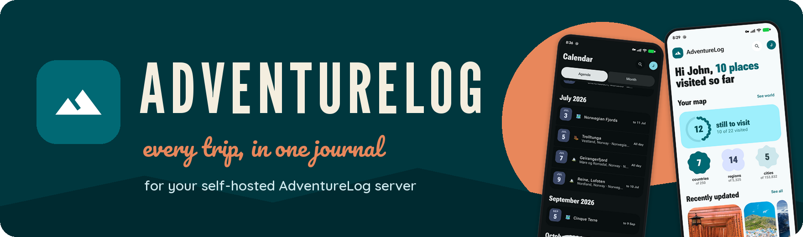
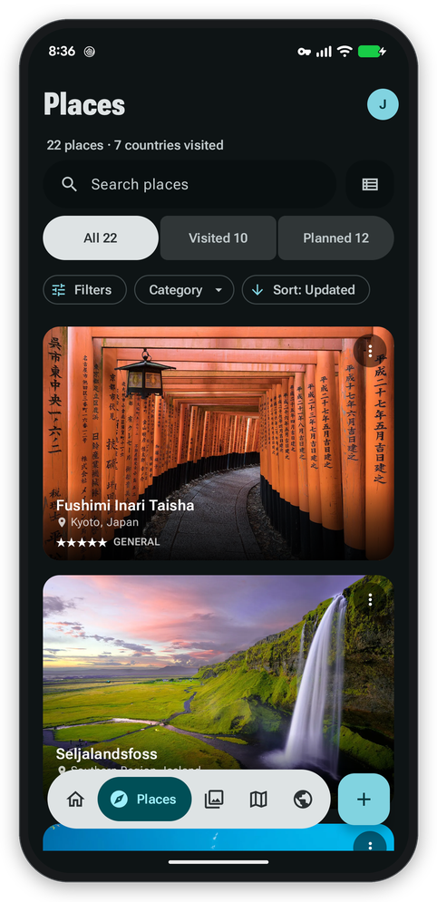
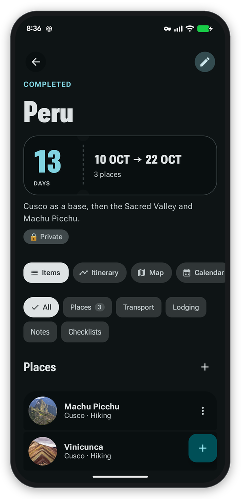
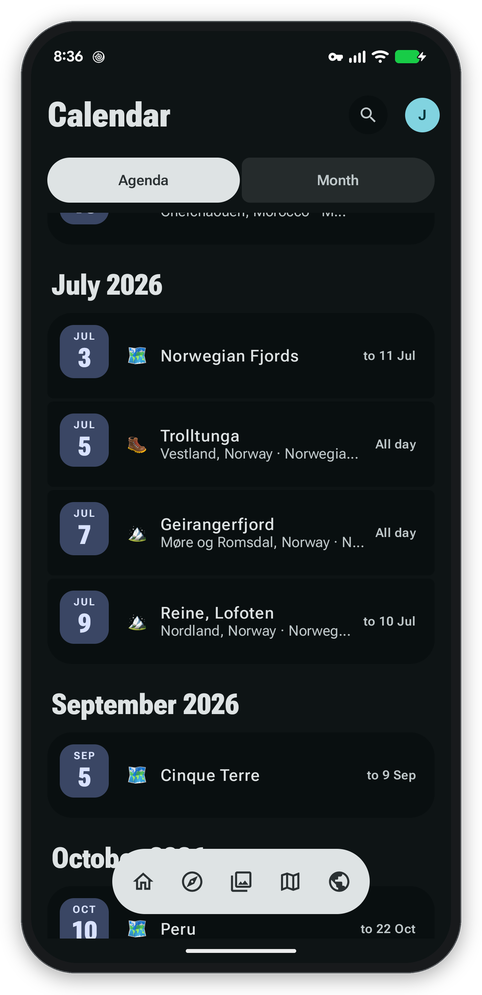
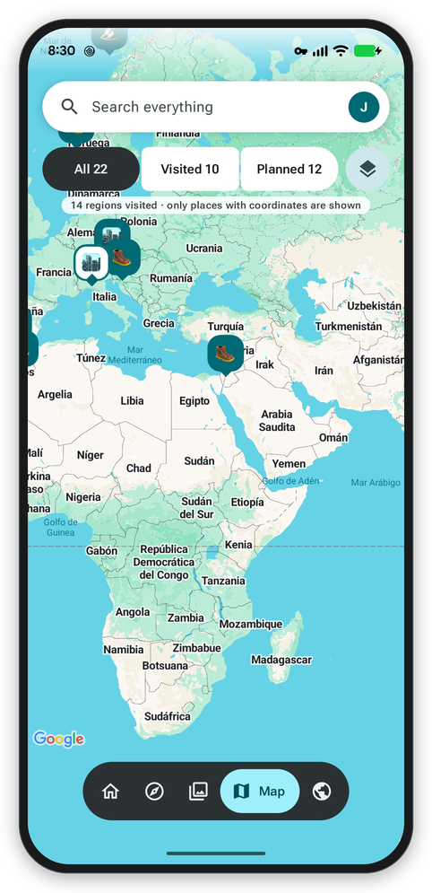
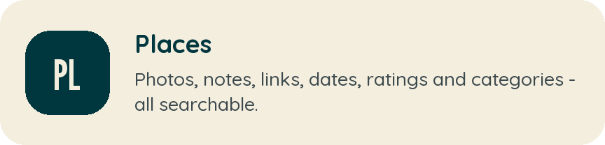
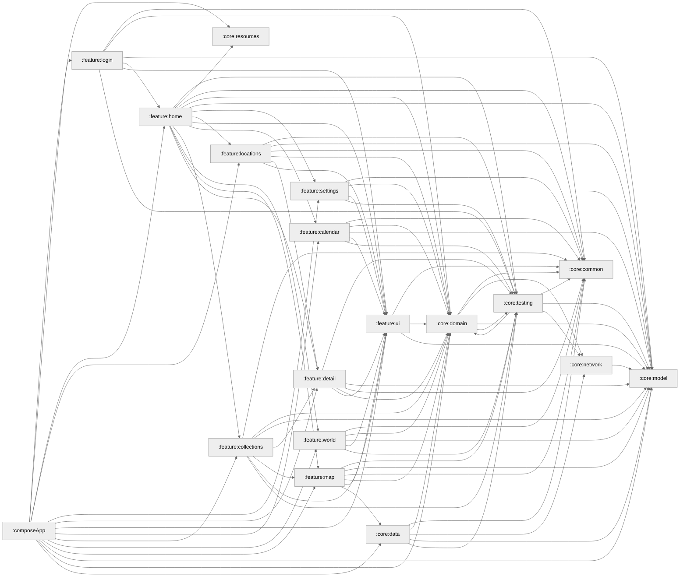

<div align="center">

<picture><source media="(prefers-color-scheme: dark)" srcset="docs/readme/dark/banner.png"></picture>

<p>
<a href="https://play.google.com/store/apps/details?id=com.desarrollodroide.adventurelog"><picture><source media="(prefers-color-scheme: dark)" srcset="docs/readme/dark/btn-play.png"></picture></a>
<a href="https://github.com/DesarrolloAntonio/AdventureLog-Client/releases/latest"><picture><source media="(prefers-color-scheme: dark)" srcset="docs/readme/dark/btn-apk.png"></picture></a>
<a href="https://github.com/seanmorley15/AdventureLog"><picture><source media="(prefers-color-scheme: dark)" srcset="docs/readme/dark/btn-server.png"></picture></a>
</p>

<p>
<picture><source media="(prefers-color-scheme: dark)" srcset="docs/readme/dark/badge-selfhosted.png"></picture>
<picture><source media="(prefers-color-scheme: dark)" srcset="docs/readme/dark/badge-kmp.png"></picture>
<picture><source media="(prefers-color-scheme: dark)" srcset="docs/readme/dark/badge-m3e.png"></picture>
<picture><source media="(prefers-color-scheme: dark)" srcset="docs/readme/dark/badge-android.png"></picture>
<picture><source media="(prefers-color-scheme: dark)" srcset="docs/readme/dark/badge-ios.png"></picture>
<picture><source media="(prefers-color-scheme: dark)" srcset="docs/readme/dark/badge-servers.png"></picture>
<picture><source media="(prefers-color-scheme: dark)" srcset="docs/readme/dark/badge-mit.png"></picture>
</p>

[](https://github.com/DesarrolloAntonio/AdventureLog-Client/actions/workflows/ci.yml)

</div>

A mobile client for [AdventureLog](https://github.com/seanmorley15/AdventureLog), the self-hosted travel journal. Log the places you have
been, group them into trips, and see it all on a map, a calendar and a world of visited countries -
on your own server.

The logic is shared through Kotlin Multiplatform; the interface is not. **Android** is Jetpack
Compose in Material 3 Expressive, on phones and tablets, and is what is released. **iOS** is a
SwiftUI app in Liquid Glass, under construction and not distributed yet.

### <picture><source media="(prefers-color-scheme: dark)" srcset="docs/readme/dark/h-screenshots.png"></picture>

<table>
  <tr>
    <td align="center" width="33%"><br/><sub><b>Home</b><br/>what is coming up, and where you have been</sub></td>
    <td align="center" width="33%"><br/><sub><b>Places</b><br/>everywhere you have logged, searchable</sub></td>
    <td align="center" width="33%"><br/><sub><b>A place</b><br/>photos, notes, links and dates</sub></td>
  </tr>
  <tr>
    <td align="center" width="33%"><br/><sub><b>Collections</b><br/>trips, each gathering its own places</sub></td>
    <td align="center" width="33%"><br/><sub><b>Inside a collection</b><br/>places, transport, lodging and a daily plan</sub></td>
    <td align="center" width="33%"><br/><sub><b>Calendar</b><br/>the journal by date</sub></td>
  </tr>
  <tr>
    <td align="center" width="33%"><br/><sub><b>Map</b><br/>everything with coordinates, clustered</sub></td>
    <td align="center" width="33%"><br/><sub><b>World</b><br/>countries, regions and cities visited</sub></td>
    <td align="center" width="33%"><br/><sub><b>Search</b><br/>one box for places, trips and regions</sub></td>
  </tr>
</table>

<sub>Android, on a Pixel 6a, light and dark theme. Photos come from Wikimedia Commons through the
server's own image search.</sub>

### <picture><source media="(prefers-color-scheme: dark)" srcset="docs/readme/dark/h-ios.png"></picture>

The iOS app is being built in SwiftUI with Liquid Glass (iOS 26). It shares the ViewModels and
everything below them with Android, and draws its own screens. It is not distributed yet;
screenshots will appear here when it is.

### <picture><source media="(prefers-color-scheme: dark)" srcset="docs/readme/dark/h-features.png"></picture>

<div align="center">
<picture><source media="(prefers-color-scheme: dark)" srcset="docs/readme/dark/card-places.png"></picture>
<picture><source media="(prefers-color-scheme: dark)" srcset="docs/readme/dark/card-collections.png"></picture>
<picture><source media="(prefers-color-scheme: dark)" srcset="docs/readme/dark/card-map.png"></picture>
<picture><source media="(prefers-color-scheme: dark)" srcset="docs/readme/dark/card-world.png"></picture>
<picture><source media="(prefers-color-scheme: dark)" srcset="docs/readme/dark/card-search.png"></picture>
<picture><source media="(prefers-color-scheme: dark)" srcset="docs/readme/dark/card-tablets.png"></picture>
</div>

<details>
<summary><b>Everything it does</b></summary>
<br>

- **Places**: add, edit and search them, with photos, notes, links, dates, ratings and categories
- **Collections**: trips that gather their own places, transport, lodging, notes and checklists
- **Itinerary**: a day-by-day plan inside each collection
- **Map**: everything with coordinates, clustered and filterable; on a tablet, the places in view beside it
- **Calendar**: everything with a date on it, as an agenda or a month
- **World**: countries, regions and cities visited, with statistics and a stamp per country
- **Search**: one box for places, collections, cities and countries
- **Sharing**: invite someone with a public profile to a collection, or remove them again
- **Markdown descriptions**: rendered as written on the web
- **Tablets**: navigation rail, adaptive grids, and list and detail side by side in Places, Collections and World
- **Sign-in**: password, two-step verification, and the server's providers (OIDC, GitHub...) on 0.14
- **Servers**: AdventureLog 0.13 and 0.14

</details>

### <picture><source media="(prefers-color-scheme: dark)" srcset="docs/readme/dark/h-install.png"></picture>

This is a *client*: it needs a [self-hosted AdventureLog server](https://github.com/seanmorley15/AdventureLog) to talk to.

Get it on [Google Play](https://play.google.com/store/apps/details?id=com.desarrollodroide.adventurelog), or download the APK from the [latest release](https://github.com/DesarrolloAntonio/AdventureLog-Client/releases/latest).
Android 7.0 and up. Then sign in with your server's address and your account.

Bug reports are welcome as [issues](https://github.com/DesarrolloAntonio/AdventureLog-Client/issues/new):
what you did, what happened instead, and the device and Android version. A screenshot helps.

### <picture><source media="(prefers-color-scheme: dark)" srcset="docs/readme/dark/h-architecture.png"></picture>

Clean Architecture split into Gradle modules: `core` holds the domain, data and network layers,
and each screen lives in its own `feature` module. ViewModels expose immutable UI state as
`StateFlow`.

UI is per platform: ViewModels and everything below them are shared, every `@Composable` lives in
`androidMain`, and iOS is SwiftUI, which sees the shared code through [SKIE](https://skie.touchlab.co/).
See the [design](docs/superpowers/specs/2026-11-21-native-ui-split-design.md).

**Stack:** [Jetpack Compose](https://developer.android.com/jetpack/compose) with Material 3
Expressive · [Compose Navigation](https://developer.android.com/guide/navigation/design), with
[Navigation 3](https://developer.android.com/guide/navigation/navigation-3) for the list-detail panes ·
[Koin](https://insert-koin.io/) · [Ktor](https://ktor.io/) (OkHttp on Android, Darwin on iOS) ·
[Kotlinx Serialization](https://github.com/Kotlin/kotlinx.serialization) ·
[Coil](https://coil-kt.github.io/coil/) ·
[Multiplatform Settings](https://github.com/russhwolf/multiplatform-settings) · Coroutines and Flow ·
SwiftUI on iOS

<details>
<summary><b>Project layout</b></summary>
<br>

```
AdventureLog/
├── composeApp/           # Android app and iOS framework, app-wide navigation and DI
├── iosApp/               # SwiftUI app (Xcode project)
├── build-logic/          # Gradle convention plugins
├── core/
│   ├── common/           # Utilities and extensions
│   ├── data/             # Repository implementations
│   ├── domain/           # Use cases and repository interfaces
│   ├── model/            # Domain models
│   ├── network/          # Ktor client and API DTOs
│   ├── permissions/      # Runtime permissions
│   ├── resources/        # Fonts and strings (Android only)
│   └── testing/          # Hand-written fakes shared by the tests
└── feature/
    ├── calendar/         # Dated events as an agenda
    ├── collections/      # Collections and what is inside them
    ├── detail/           # A place's own page
    ├── home/             # App shell, navigation bar and dashboard
    ├── locations/        # The places list, and adding or editing one
    ├── login/            # Sign-in
    ├── map/              # Map
    ├── settings/         # Account and app settings
    ├── ui/               # Shared Android UI components and theme
    └── world/            # Countries, regions and cities
```

</details>

### Module Graph


### <picture><source media="(prefers-color-scheme: dark)" srcset="docs/readme/dark/h-build.png"></picture>

**Requirements:** an Android Studio recent enough for AGP 9.2, JDK 17, and Xcode 26 for iOS
(iOS 26 minimum).

```bash
git clone https://github.com/DesarrolloAntonio/AdventureLog-Client.git
cd AdventureLog-Client
./gradlew :composeApp:assembleDebug
```

- **Android**: open the project in Android Studio and run the `composeApp` configuration.
- **iOS**: run `./gradlew :composeApp:embedAndSignAppleFrameworkForXcode`, then open
  `iosApp/iosApp.xcodeproj` in Xcode and run it. The SwiftUI screens are still under construction.

### <picture><source media="(prefers-color-scheme: dark)" srcset="docs/readme/dark/h-tests.png"></picture>

- **Unit tests** (`commonTest`, on Android and iOS): models, mappers, use cases, the network and
  data layers, and every feature's ViewModels, using the fakes in `core/testing`. Tests of
  Android-only UI logic live in `androidUnitTest`.
- **Shared-code check**: `scripts/check-common-compose.sh` fails if Compose reaches `commonMain`.
- **UI tests** (`androidInstrumentedTest`, need a device or emulator): screens and shared
  components in every feature module - `calendar`, `collections`, `detail`, `home`, `locations`,
  `login`, `map`, `settings`, `ui` and `world`.
- **Flows**: one Maestro flow in `.maestro/`.

```bash
./gradlew allTests testDebugUnitTest      # unit tests, every target
./gradlew connectedDebugAndroidTest       # UI tests, with a device attached
```

CI runs the unit tests, compiles the iOS framework and builds the app; the UI tests and the Maestro
flow run locally.

### <picture><source media="(prefers-color-scheme: dark)" srcset="docs/readme/dark/h-issues.png"></picture>

- **Sign-in providers** (OIDC, GitHub...) need server 0.14: 0.13 has no way for an app to use them.
  The server must also list `adventurelog://auth/callback` in `MOBILE_AUTH_REDIRECT_URIS`, which
  it does unless that setting was changed.
- **iOS**: the SwiftUI app is under construction and not distributed yet.

### <picture><source media="(prefers-color-scheme: dark)" srcset="docs/readme/dark/h-license.png"></picture>

MIT - see [LICENSE](LICENSE).
